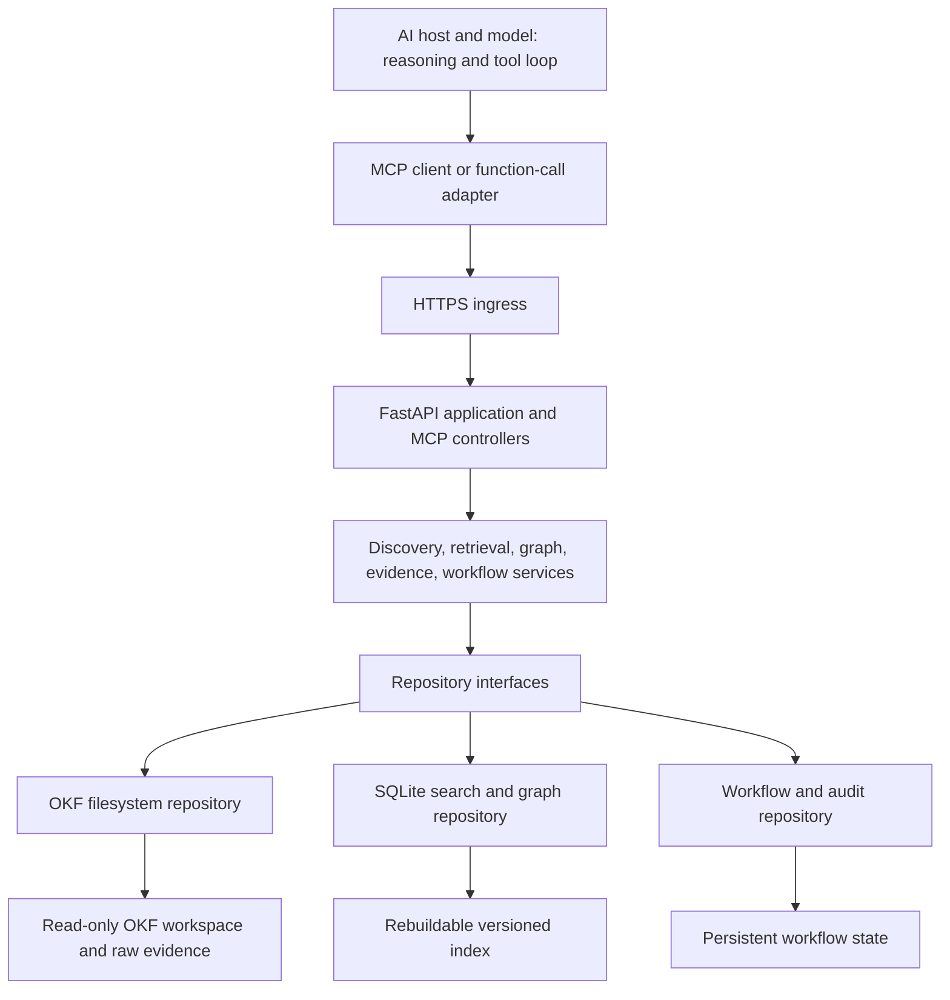

# LLM Wiki MCP development plan

Planning date: 12 October 2026, Asia/Jakarta. Status: proposed implementation roadmap; the server has not been implemented or deployed.

Build a provider-independent MCP server hosted by **FastAPI**, using the official Python MCP SDK for protocol handling. Keep the OKF Markdown workspace authoritative, derive a searchable knowledge graph from its links and provenance, and expose tools for discovery, retrieval, evidence assessment, and durable agent workflows. Package the application in Docker.

The connected AI host supplies the model, reasoning, and tool-call loop. The server supplies evidence and the operations that let that loop plan, investigate, compare, verify, and resume. A provider must have an MCP-capable host or an adapter that translates its function calls into MCP calls; an endpoint alone cannot make every model or cloud API support MCP or reason reliably.

## 1. Requirements and delivery evidence

| Requirement | Planned decision | Evidence required before release |
|---|---|---|
| Python and FastAPI | FastAPI owns the application, lifecycle, authentication integration, and operational routes; an official MCP SDK ASGI application handles MCP requests. | A real MCP client discovers and calls tools through the FastAPI-hosted endpoint. |
| Open Knowledge Format and connected knowledge | OKF v0.2 parser with links, backlinks, provenance, unresolved targets, and graph traversal; optional adapter for this repository's producer profile. | Graph edges resolve to actual metadata or Markdown spans; generic OKF and stock-analysis fixtures both work. |
| Provider reasoning and agentic workflows | Structured evidence tools, bounded graph exploration, comparison support, resumable plans, checkpoints, and citation checks. | The same research workflow completes through two independent AI host/provider integrations. |
| Controller, service, repository | Controllers validate and translate; services implement use cases; repositories provide storage behind interfaces. | Dependency checks prevent services and repositories from importing controllers. |
| Docker | Reproducible container build, persistent state volume, read-only wiki mount, and health probes. | Container restart preserves workflows, while index reconstruction preserves wiki contents. |
| Distinct tool categories | Names and registration modules separate discovery, retrieval, graph, reasoning, workflow, quality, and administration. | A documented tools catalog matches `tools/list` and its schemas. |
| Stable Python with a maintenance path | Python 3.14 baseline; exact patch pinned at implementation; Python 3.15 qualification and regular dependency updates. | Dependency installation, tests, and container builds pass on each supported interpreter. |

## 2. Existing wiki baseline

The supplied workspace is [wiki-agentic-stock-analysis](../wiki-agentic-stock-analysis/), with this layout:

```text
wiki-agentic-stock-analysis/
  collection.json            # collection-specific scope and policy
  manifest.json              # accepted source identities, hashes, completion
  raw/<source-id>/...         # immutable original Markdown and attachments
  wiki/                      # OKF bundle root
    index.md
    log.md
    overview.md
    sources/<source-id>.md
    entities/<slug>.md
    concepts/<slug>.md
```

Inspected baseline: **28 accepted and completed sources, 12 entity pages, 11 concept pages, and one overview**, giving 52 content pages. Indexes and the log are additional navigation/operational documents. The manifest records `okf_version: "0.2"`, a two-source synthesis threshold, hashes, and `pending_tail: false`.

The existing validator was rerun during planning: no structural errors, no evidence errors, and six candidate-link warnings representing three unresolved entity targets: `bksldrcv6a`, `tjokro-group`, and `freeport-indonesia`. Model these as declared candidates rather than creating knowledge pages for them.

Important existing contracts:

- Paths identify pages; stable `source_id` values identify accepted raw evidence.
- `sources[].id` and `sources[].resource` connect page claims to provenance. Keyed footnotes locate their citations.
- `entities` and `concepts` metadata declare topic engagements. These are this template's extensions.
- `report_context` retains ticker, strategy, horizon, report timestamp, technical cut-off, forecast dates, and timezone. Preserve the original strings alongside any normalized fields.
- Entity/concept synthesis needs two distinct accepted source IDs. Distinct IDs do not establish independent corroboration; aliases, query answers, and synthesized pages add no evidence votes.
- Raw snapshots are immutable. Unknown metadata, generation metadata, manual edits, and human notes must survive any future write workflow.

Implement **two input modes**. `okf_bundle` accepts an ordinary OKF bundle without requiring `manifest.json`, `raw/`, the stock profile, or these page types. `template_workspace` adds companion evidence and this template's stricter checks. Unknown `type` values remain retrievable as generic knowledge nodes. Base OKF permits a document with only a `type`; the producer's title, coverage, and synthesis rules must not become universal OKF requirements. See the [pinned OKF specification](https://github.com/GoogleCloudPlatform/open-knowledge-format/blob/0b87c52c6ef999286c745e19998fdfcd03d5dbee/SPEC.md) and [local conventions](../.agents/skills/llm-wiki-markdown/references/conventions.md).

## 3. Runtime and protocol decisions

| Component | Decision | Rationale |
|---|---|---|
| Python | CPython **3.14**, latest verified patch at implementation; use the standard GIL build initially. | Mature stable branch with planned support through October 2030. |
| Upgrade target | Qualify Python **3.15** in CI, then enable it after dependency, behavior, and Docker checks pass. | 3.15 is already stable as of this plan; its planned support extends to October 2031. |
| Web application | FastAPI with Uvicorn | Required application framework and ASGI deployment. |
| MCP library | Official `mcp` Python SDK, stable **v2** release line | Protocol handling, schemas, tools, resources, prompts, and compatibility transport. |
| Contracts | Pydantic v2 and Pydantic Settings | Typed inputs, output validation, and deployment configuration. |
| Markdown/YAML | `markdown-it-py` plus a safe PyYAML loader that rejects duplicate keys | Parse document structure and links without executing content. |
| Initial storage | SQLite with FTS5 and relational graph tables | Adequate for this corpus; supports search, adjacency, transactions, and durable workflows. |
| Dependency management | `uv`, `pyproject.toml`, and committed `uv.lock` | Repeatable local, CI, and container environments. |
| Verification | pytest, HTTPX/MCP clients, Ruff, and a type checker | Service, repository, transport, and integration checks. |

These version facts were checked against the [Python version lifecycle](https://devguide.python.org/versions/) and [official SDK documentation](https://py.sdk.modelcontextprotocol.io/). Do not select an unsupported interpreter or a prerelease SDK to satisfy a release target. At project creation, use `requires-python = ">=3.14,<3.15"`; widen to `<3.16` only when 3.15 becomes a supported runtime. Pin the runtime patch and container digest in deployment configuration, test patch updates regularly, and review the next stable Python minor annually. Future support comes from this update process.

Target MCP **2026-07-28**, while testing **2025-11-25** compatibility through the SDK. Current Streamable HTTP uses self-contained requests and removes protocol-level sessions; older clients use initialization and may use sessions. Keep domain workflows independent of both transport behaviors. Let the SDK validate metadata, version headers, and JSON-RPC rather than implementing a second protocol stack. These choices follow the [current transport specification](https://modelcontextprotocol.io/specification/2026-07-28/basic/transports/streamable-http) and [SDK compatibility guidance](https://py.sdk.modelcontextprotocol.io/run/legacy-clients/).

## 4. Controller, service, and repository architecture



| Layer | Responsibilities | Boundary |
|---|---|---|
| Controllers | Register categorized MCP tools/resources/prompts; validate inputs; establish principal and wiki access; call services; translate results and errors. FastAPI controllers provide health and restricted administration. | No filesystem parsing, graph algorithms, SQL, or research logic. |
| Services | Resolve identity, select evidence, traverse graphs, apply context filters, construct comparison panels, enforce budgets, validate workflow transitions, and coordinate indexing. | Depend on domain models and repository interfaces; no transport objects or provider SDK dependencies. |
| Repositories | Read Markdown and manifests; store/query page, section, citation, edge, FTS, workflow, and audit records; provide transactions and snapshot access. | No tool descriptions, prompt construction, or model decisions. |
| Domain/adapters | Plain models and policies; generic OKF parsing with an optional stock-analysis metadata adapter. | Stock-specific rules cannot become requirements for other wikis. |

Compose repositories and services once in the application factory/lifespan. FastAPI dependency injection and MCP handler dependency wiring must both access that container explicitly; FastAPI `Depends` does not automatically apply to mounted MCP handlers. Enforce authorization on every tool call and resource read, including operations reached by guessed IDs.

FastAPI owns startup/shutdown for database access, initial validation, the SDK transport manager, and worker lifecycle. Create the SDK ASGI app before accessing its manager; explicitly enter its lifecycle in the parent app. Register FastAPI operational routes before any root mount. Keep the internal MCP path and mount prefix consistent, and test the public URL and trailing-slash behavior so the deployment does not accidentally serve `/mcp/mcp` or require POST redirects. The [SDK ASGI mounting guide](https://py.sdk.modelcontextprotocol.io/run/asgi/) documents the lifecycle requirement; [FastAPI lifespan](https://fastapi.tiangolo.com/advanced/events/) provides the parent lifecycle mechanism.

Proposed layout:

```text
mcp-server/
  pyproject.toml
  uv.lock
  .python-version
  Dockerfile
  compose.yaml
  .dockerignore
  .env.example
  src/llm_wiki_mcp/
    app.py
    config.py
    container.py
    controllers/
      mcp/{discovery,retrieval,graph,reasoning,workflow,quality,admin}.py
      http/{health,admin}.py
      resources.py
      prompts.py
    services/
      discovery.py
      retrieval.py
      graph.py
      evidence.py
      workflow.py
      indexing.py
      validation.py
    repositories/
      interfaces.py
      filesystem.py
      sqlite_index.py
      sqlite_workflow.py
    domain/{models,errors,policies}.py
    adapters/{okf,template_workspace,stock_analysis}.py
    workers/index_jobs.py
  tests/{unit,integration,contracts,e2e,fixtures}/
  docs/{tool-catalog,operations,client-integration}.md
```

This tree describes files to create during implementation. The planning deliverable adds only documentation to the existing repository.

## 5. Knowledge graph and index design

### Identity and storage

- Configure a stable `wiki_id` and an allowlisted root server-side. Callers select a registered wiki, never an arbitrary host path.
- Use `(wiki_id, bundle_relative_path)` as page identity and expose it as a portable URI, for example `wiki://agentic-stock-analysis/page/entities/bull.md`.
- Use accepted source IDs for template raw evidence. Generic OKF provenance retains its own IDs and resource URIs; do not assume that an ID reused across documents identifies one global source.
- Index page frontmatter, body, sections and original line spans, content hashes, lifecycle metadata, citations, outgoing links, and backlinks.
- Preserve headings and UTF-8 offsets/line mapping so retrieved excerpts can always be checked against the bytes that were indexed.

Initial tables: `wiki_snapshots`, `pages`, `sections`, `provenance_entries`, `raw_sources`, `edges`, `citations`, `candidate_targets`, `validation_findings`, `page_fts`, `workflows`, `workflow_steps`, `workflow_events`, and `jobs`. Graph/index rows carry `wiki_id` and `snapshot_id`; workflow records carry owner, version, and their pinned snapshot. Keep indexes, original evidence, and workflow state in separate storage locations even when both databases initially use SQLite.

### Edge semantics

| Edge | Extraction rule | Interpretation |
|---|---|---|
| `links_to` | Actual Markdown link or reference link to a page | A connection exists; its semantic meaning may be unspecified. |
| `navigation_link` | Link from an index or other navigation document | Navigation, excluded from evidence traversal by default. |
| `cites` | Claim footnote linked to a matching provenance entry | Attribution, retaining footnote ID and citing span. |
| `derived_from` | A page's declared `sources` entry | Provenance dependency; retain declared versus verified resolution status. |
| `summarizes` | Template source-page identity verified against manifest/raw hash | Summary-to-original relationship. |
| `engages_entity` / `engages_concept` | Template `entities` / `concepts` path fields | Declared substantive topic engagement under the producer profile. |
| `related_report` | Explicit Related reports link in the stock profile | Related dated report, retaining ticker/strategy/horizon context. |
| `context_match` | Adapter joins matching metadata | Computed relation, labeled derived and distinct from explicit links. |

Edges record origin page, target, relation, extraction basis, source span/metadata key, and target status. Paths can explain **why documents connect**; a graph path does not establish causation or entailment. Keep navigational and provenance relations separate. Semantic `supports` or `contradicts` edges require cited claim annotations; do not infer them merely from a hyperlink or different numbers.

### Parsing and resolution

Parse Markdown into tokens; avoid regex-only link extraction. Handle inline links, reference definitions, relative paths, bundle-root paths, percent encoding, and heading fragments. Resolve `/entities/x.md` against the bundle root. Permit the template's declared `../../raw/...` evidence links only within the registered workspace and approved evidence roots. Normalize first, then enforce containment; block symlink escapes. Preserve external URIs as references without fetching them. Distinguish images/attachments from knowledge pages and explicitly report unsupported syntax.

Keep missing targets as candidate or unresolved records with `materialized: false`. A generic OKF bundle can retain broken links as warnings; the template profile enforces its stricter provenance rules. In graph traversal use a visited set and configurable caps on depth, nodes, edges, and elapsed time. Return truncation and a continuation cursor rather than silently presenting a partial graph as complete.

### Search, refresh, and consistency

1. Validate and build a full initial index with SQLite FTS5/BM25 over titles, aliases, descriptions, headings, and body sections. Verify FTS5 exists in the selected container runtime.
2. Combine exact identity/alias lookup, lexical results, metadata filters, and bounded graph expansion. Rank exact topic matches and content relationships ahead of navigation hubs. Return score components and matched passages.
3. Detect edits through hashes and a scheduled scan or explicit rebuild. Update changed records and remove deleted records within a new snapshot. Never change original pages to refresh an index.
4. Build into staging, validate, and publish a snapshot atomically. Do not expose half-updated graph/search results. Quarantine hash-invalid template evidence and report the impacted pages.
5. Retain snapshot content required by active workflows in the derived store, including pinned raw excerpts where permitted. Never answer an old-snapshot query using newly changed filesystem bytes. Return `SNAPSHOT_EXPIRED` if the requested version is no longer retained.
6. Keep manual page changes visible with validation findings; accepted raw-hash failure is an evidence-integrity error. Page-hash drift alone is not proof that a manual edit is invalid.

For this collection, filters include `ticker`, `document_role`, `strategy_type`, `forecast_horizon_sessions`, report date, technical cut-off, and forecast dates. Store missing/unparseable values explicitly. `generated.at` is the wiki generation time, not the report date. Synthesized pages covering several contexts return their constituent context sets rather than one misleading horizon. Generic wikis can omit all these fields.

Add embeddings behind a `SearchRepository` interface only after the lexical/graph evaluation shows a useful recall gap. A future graph database can implement `GraphRepository` if measured scale warrants it; neither change should alter tool contracts or make embeddings the authority for evidence.

## 6. Categorized MCP tool catalog

Use portable names such as `wiki_search`, with a category in the description and project metadata, and one registration module per category. MCP supplies a flat tool list; categories are an application convention. Every permitted core tool is discoverable through `tools/list` from release startup. Keep descriptions concise and publish the expanded contracts in the tool catalog.

All wiki operations accept `wiki_id`; after discovery, graph/retrieval/evidence calls also accept `snapshot_id`. The signatures below list other principal arguments. **R** reads wiki/state, **W** writes workflow state, and **A** is an administrative operation. P0–P5 refer to the delivery phases below.

### Discovery — P2

| Tool | Main arguments | Result/purpose | Access |
|---|---|---|---|
| `wiki_list` | optional cursor | Authorized wiki IDs, scope, format/profile, capabilities, active snapshot, counts. | R |
| `wiki_overview` | wiki ID | Navigation, coverage, limitations, report contexts, and candidate topics. | R |
| `wiki_search` | query, filters, limit, cursor | Ranked page/section hits, snippets, context, citations, score explanation. | R |
| `wiki_resolve` | label, optional type | Canonical page/alias matches; explicit ambiguity and unresolved candidates. | R |

### Retrieval — P2

| Tool | Main arguments | Result/purpose | Access |
|---|---|---|---|
| `wiki_get_page` | page ID, optional section or line range | Metadata, bounded Markdown, citations, hash, total lines, continuation. | R |
| `wiki_get_pages` | bounded page IDs, per-page budget | Batch retrieval with individual results/errors and shared snapshot. | R |
| `wiki_get_evidence` | accepted source ID, line range | Verified raw passage, original line coordinates, hash, report context, completeness status; unavailable-original result for bundle-only mode. | R |

### Knowledge graph — P2

| Tool | Main arguments | Result/purpose | Access |
|---|---|---|---|
| `wiki_neighbors` | page ID, direction, relation filters, cursor | Links and backlinks, including explicitly marked unresolved targets. | R |
| `wiki_subgraph` | seed IDs, depth, relation filters, budgets | Bounded nodes/edges plus extraction basis and truncation. | R |
| `wiki_find_paths` | from/to IDs, allowed relations, max hops, limit | Shortest bounded connection paths with the origin of every edge. | R |
| `wiki_provenance` | page/section ID, depth | Citation chain to source summaries/originals, deduplicated evidence IDs, verification and dependence caveats. | R |

### Reasoning support — P3

| Tool | Main arguments | Result/purpose | Access |
|---|---|---|---|
| `wiki_collect_context` | seed IDs or query, filters, evidence/byte budgets | Deterministic evidence packet: relevant excerpts, provenance, context distinctions, declared limitations, and follow-up candidates. | R |
| `wiki_compare` | page IDs, requested fields/sections | Aligned context and passage panel; explicit differences in comparable structured fields, missing fields, and unresolved semantic questions. | R |
| `wiki_check_coverage` | topic IDs, required contexts/fields | Corpus coverage matrix, accepted-source counts, missing combinations and unresolved citations; completeness scoped to indexed metadata. | R |
| `wiki_check_citations` | proposed claim records with citation IDs/spans | Existence, hash, span, identity, and context checks; `semantic_support: not_assessed` for checks requiring model judgment. | R |

The AI interprets comparison passages and drafts conclusions. These tools do not claim to resolve arbitrary contradiction, prove prose entails a claim, assign objective confidence, or generate unsupported knowledge. Unknown support remains unknown. Source counts measure distinct accepted artifacts; report agreement and model annotations do not become independent corroboration.

### Agent workflow — P3

| Tool | Main arguments | Result/purpose | Access |
|---|---|---|---|
| `workflow_create` | goal, constraints, template or explicit steps, budgets, idempotency key | Durable workflow ID, pinned snapshot, step dependencies, and initial status. The host supplies novel planning. | W |
| `workflow_get` | workflow ID | Plan, progress, evidence references, context constraints, unresolved questions, next eligible steps. | R |
| `workflow_checkpoint` | workflow ID, expected version, step/event, artifacts, idempotency key | Atomic event and checkpoint, updated state/version, remaining budget. | W |
| `workflow_finalize` | workflow ID, expected version, answer artifact with claims/citations | Validated artifact references, unresolved gaps, completed or incomplete result, and pages used. | W |
| `workflow_cancel` | workflow ID, expected version, idempotency key | Terminal cancellation and preserved audit trail. | W |

Resuming uses `workflow_get` followed by further checkpoints with the same ID; a second resume tool is unnecessary. Model-generated claims are workflow artifacts, never newly accepted evidence or automatic wiki edits. Checkpoints store concise findings, decisions, and citations rather than private chain-of-thought.

### Quality — P4

| Tool | Main arguments | Result/purpose | Access |
|---|---|---|---|
| `wiki_validate` | scope: bundle/profile/index, optional page IDs | Structural, provenance, integrity, candidate-link, and index consistency findings. | R |
| `wiki_index_status` | wiki ID | Active snapshot, index age, job state, failed evidence and rebuild need. | R |

### Administration — P4

| Tool | Main arguments | Result/purpose | Access |
|---|---|---|---|
| `admin_rebuild_index` | wiki ID, full/incremental, idempotency key | Durable bounded rebuild job ID; no wiki mutation. | A |
| `admin_get_job` | job ID | Authorized job status, diagnostics, and published snapshot. | A |

These are **24 core tools**. Administration tools are listed only for principals with administrative access. All callers still receive the read-only index-status tool.

### Optional knowledge maintenance — after P5

If wiki authoring is later requested, add a separate writer profile with `maintenance_stage`, `maintenance_validate`, and `maintenance_commit`. Stage an explicit proposed change set, display its diff, validate profile rules and expected hashes, and commit under a per-workspace exclusive writer lock. Keep raw evidence immutable, preserve unknown metadata and human notes, and route source completion/index/log ownership through the existing helper contracts. New source ingestion must read complete originals and produce valid receipts.

This is a separate release gate because the present adapter explicitly defers source revisions and retirement. Define crash recovery for any multi-file commit before enabling it. Do not add unrestricted file-write, shell-execution, URL-fetch, or automatic answer-to-wiki tools to the initial research server.

## 7. Shared contracts, resources, and prompts

Every tool gets typed input/output models, a stable error contract, limits, at least one example, access scope, and accurate MCP annotations. Read tools use `readOnlyHint: true`; workflow mutations use `readOnlyHint: false`, with idempotency only where the service actually guarantees it. Tool hints describe behavior; service-side authorization enforces it.

Return an MCP result containing `structuredContent` conforming to `outputSchema`, with a compatible text representation where required by clients. The following fields live inside the application's payload, not as new JSON-RPC fields:

```json
{
  "schema_version": "1.0",
  "wiki_id": "agentic-stock-analysis",
  "snapshot_id": "<snapshot-id>",
  "data": {},
  "citations": [],
  "warnings": [],
  "truncated": false,
  "next_cursor": null
}
```

Citation records include page URI, page hash, section/line span, provenance ID, raw source ID when available, raw hash/span when actually read, report context, and verification status. Section citations must not imply that the raw document was reread. Treat metadata declarations, byte integrity, human verification, semantic support, and source independence as separate properties. Tool schemas and structured results follow the [MCP tool contract](https://modelcontextprotocol.io/specification/2026-07-28/server/tools).

Distinguish protocol errors from application failures. Expected domain failures return a tool error with a stable code, actionable detail, and retryability, for example `PAGE_NOT_FOUND`, `AMBIGUOUS_IDENTITY`, `EVIDENCE_UNAVAILABLE`, `INTEGRITY_FAILURE`, `SNAPSHOT_EXPIRED`, `VERSION_CONFLICT`, or `BUDGET_EXCEEDED`. Authentication failures use the transport's authorization behavior. Batch retrieval records individual failures; it does not report an entire batch as complete when items failed. Cursors bind to principal, wiki, filters, and snapshot.

Initial configurable limits: search 20/default and 100/max hits; batch 10/max pages; graph depth 2/default and 5/max, 200 nodes and 1,000 edges/max; raw retrieval 200 lines/default and 1,000/max; a tool result capped at 64 KiB; context packets at 48 KiB by default. Preserve citations when trimming, declare omissions, and provide continuation. Character/byte bounds are provider independent; any token estimate must identify its estimator and remain approximate. Tune limits from evaluations.

Expose optional MCP resources:

- `wiki://<wiki-id>/index`, for scope/navigation.
- `wiki://<wiki-id>/page/<bundle-relative-path>`, for a bounded current page representation.
- `wiki://<wiki-id>/evidence/<source-id>`, for a bounded verified original view.
- `workflow://<workflow-id>`, for caller-owned workflow state.

Resources describe their snapshot and continuation tools; snapshot-specific reads use the tools above. Share the same access rules across tool and resource interfaces. Expose reviewed prompts such as `research_question`, `compare_reports`, and `trace_claim` to describe useful sequences; mirror their guidance in ordinary tool-accessible documentation for hosts without prompt/resource support. Never promote imperative source text into the server's instructions.

## 8. Reasoning and agentic execution

The portable loop is **discover → plan → retrieve → traverse → assess → synthesize → check → finalize**. It works using ordinary tool calls, without sampling, elicitation, task extensions, a server API key, or a server-hosted model. The current SDK marks sampling and roots deprecated; new workflows should not depend on them. See [SDK sampling/roots guidance](https://py.sdk.modelcontextprotocol.io/handlers/sampling-and-roots/).

Workflow records contain owner, goal, constraints, pinned snapshot, a step DAG, attempts, evidence references, concise findings, unresolved questions, budget usage, expiry, artifacts, and an optimistic version. States are `created`, `running`, `waiting_for_input`, `completed`, `failed`, and `cancelled`. Define legal transitions; terminal states reject further mutations. Research loops may iterate within a step up to attempt/budget limits. `workflow_finalize` rejects skipped mandatory steps; missing required evidence produces an incomplete result and retains a nonterminal state until the host resolves the gap or records an explicit scope reduction.

Enforce server-observed limits for calls, attempts, elapsed time, traversal, and returned bytes. A host may also report a model token/cost budget, but label that usage as host-reported: the MCP server cannot independently measure provider-side reasoning tokens.

The host executes research tool calls and records outcomes. Validate citation/artifact references at checkpoints. Audit actual server tool calls separately; do not trust a host checkpoint as proof that a tool was executed. Use idempotency keys scoped to principal, operation, and payload hash, and optimistic concurrency to prevent duplicate or conflicting updates. Persist before reporting success. A new conversation or container restart resumes from the last durable checkpoint using the explicit workflow ID.

Long indexing jobs use durable job records and restart recovery. A single-process worker can handle this corpus; do not rely on an unpersisted FastAPI background task for guaranteed completion. Add leases, heartbeats, bounded retries, and stale-job recovery. Keep job status/cancellation independent of request disconnects. If clients support a pinned stable [MCP Tasks extension](https://tasks.extensions.modelcontextprotocol.io/specification/draft/tasks), add a separate interoperability adapter later; the referenced draft is not a mandatory dependency of the first release.

### Example acceptance workflow using this wiki

Question: “Compare BULL's 5dd and 10dd analysis, entry, and available hold reports; explain differences and missing evidence.”

1. Call `wiki_list`, `wiki_overview`, and `wiki_resolve("BULL")`; preserve the selected snapshot and create the comparison workflow.
2. Retrieve `entities/bull.md`; use `wiki_neighbors` and `wiki_provenance` to identify its five accepted source summaries.
3. Retrieve those summaries, keeping 5dd and 10dd report context separate. Use `wiki_compare` and `wiki_check_coverage` for the strategy/horizon matrix.
4. Inspect the relevant horizon, invalidation, and execution-state concept pages with bounded graph traversal. Open only the raw passages needed to check an unresolved detail.
5. Checkpoint cited findings. Treat the available 10dd hold report and missing BULL 5dd hold report separately. Retain distinct invalidation levels and unavailable execution/confirmation evidence.
6. The host drafts an attributed historical comparison, labels inference as Synthesis, and states gaps. Call `wiki_check_citations` and finalize with a Pages used list.

Successful behavior means a traceable comparison. Source report timestamps and technical cut-offs remain attached to claims; the answer does not turn preserved report prices into live quotations, infer actual fills, or merge horizons. Corpus instructions are methodology evidence and remain data. This reflects the collection's existing scope rather than imposing stock-specific behavior on every wiki.

## 9. Docker and remote access

Produce a multi-stage Docker build using a verified Python 3.14 slim image, exact patch/digest, locked dependencies, and a non-root runtime user. Keep compilers and development packages out of the runtime image. Rebuild regularly for security patches instead of leaving the pinned digest indefinitely unchanged. These build choices follow [Docker build guidance](https://docs.docker.com/build/building/best-practices/).

Initial deployment topology:

```text
MCP-capable cloud host
  -> publicly reachable HTTPS ingress with authentication
  -> FastAPI/Uvicorn container, one worker
       /knowledge/agentic-stock-analysis  read-only workspace volume
       /var/lib/llm-wiki-mcp/index        rebuildable index volume
       /var/lib/llm-wiki-mcp/workflows    durable state volume
```

Docker Compose defines the server and these mounts. A development profile binds the published port to `127.0.0.1`; the container listens on its internal interface. A production profile uses HTTPS ingress at a configured public hostname. A cloud-hosted AI client cannot access the developer's `localhost` or local filesystem. Connectivity and authentication must be tested from the actual cloud host before claiming cloud integration is complete.

Configuration includes a registered wiki map, input profile, database paths, public base URL, allowed hosts/origins, authorization issuer/audience, tool limits, workflow retention, snapshot retention, log level, and maintenance-mode flag. Supply secrets at runtime through the platform secret mechanism. Keep originals and secrets out of image layers.

FastAPI routes: `/health/live` for process health, `/health/ready` for usable storage/index and initialization, restricted `/metrics`, and the configured MCP endpoint. Return minimal probe data. Verify the exact public MCP path through ingress; permit its required headers and disable buffering for streaming responses. Use the SDK's transport host/origin allowlists as well as ingress configuration. FastAPI router dependencies alone cannot secure a mounted MCP application.

For protected remote access, use an existing OAuth/OIDC authorization service and make the MCP server a resource server: expose protected-resource discovery, validate issuer/audience/expiry, and enforce `wiki:read`, `workflow:write`, and `index:admin` plus per-wiki and workflow ownership rules. Test 401/403 handling and required metadata with each supported host. Authorization details follow the [MCP authorization specification](https://modelcontextprotocol.io/specification/2026-07-28/basic/authorization). Do not require access to an AI provider's model API key for normal research calls.

Run one worker initially. Multiple readers may query SQLite; use short transactions, a single index publisher, and local persistent storage rather than a shared network filesystem. Back up workflow state and its retained snapshots together, and verify restore. Retain the original workspace in its own existing backup/versioning process.

Scale after measurement: move workflow/jobs to a shared transactional database, give replicas access to the same immutable index snapshots, and retain snapshot compatibility across replicas. Stateful legacy transport may require sticky routing; alternatively qualify the SDK's stateless legacy mode when no back-channel features are needed. Modern transport sessionlessness does not make an in-memory workflow or replica-local database durable. See [SDK deployment guidance](https://py.sdk.modelcontextprotocol.io/run/deploy/).

## 10. Delivery phases and estimates

Estimates assume one experienced Python engineer, a reviewer, and access to two test AI hosts. They are effort ranges, not fixed dates. Authorization/infrastructure integration and optional authoring can add time.

| Phase | Effort | Dependencies | Deliverables and exit gate |
|---|---|---|---|
| **[P0 — contracts and compatibility](mcp-phases/PHASE-0-CONTRACTS-AND-COMPATIBILITY.md)** | 2–3 days | None | Record architecture decisions, Python/SDK versions, input profiles, workflow semantics, tool schemas, snapshot and citation rules; a minimal FastAPI-mounted SDK spike passes a real client call. |
| **[P1 — repository and index](mcp-phases/PHASE-1-REPOSITORY-AND-INDEX.md)** | 4–6 days | P0 | Generic/profile parsers, safe link resolver, content spans, graph/FTS schema, hash validation, atomic snapshots and rebuild CLI. Reproduce baseline counts; candidate warnings remain distinguishable. |
| **[P2 — discovery, retrieval, graph](mcp-phases/PHASE-2-DISCOVERY-RETRIEVAL-AND-GRAPH.md)** | 4–5 days | P1 | First 11 tools, resource views, pagination, access checks, budgets, provenance and graph queries. Follow an entity through summaries to a verified raw passage without context loss. |
| **[P3 — reasoning and workflows](mcp-phases/PHASE-3-REASONING-AND-WORKFLOWS.md)** | 5–7 days | P2 | Nine evidence/workflow tools, reviewed prompt templates, durable events, concurrency/idempotency, and restart/resume. BULL workflow produces cited comparisons and reports its coverage gaps. |
| **[P4 — Docker and operational hardening](mcp-phases/PHASE-4-DOCKER-AND-OPERATIONAL-HARDENING.md)** | 3–5 days | P3 | Four quality/admin tools; production Docker/Compose, durable rebuild jobs, authorization integration, probes, metrics, backups, and operating guide. Complete all 24 tools. |
| **[P5 — evaluation and release](mcp-phases/PHASE-5-EVALUATION-AND-RELEASE.md)** | 3–4 days | P4 | Two independent host/provider integrations, protocol-era matrix, recovery/security tests, benchmark/evidence evaluation, client examples, and release checklist. |

Each linked phase plan provides implementation tasks, required deliverables, validation procedures and pass conditions, evidence to retain, and a completion/handoff gate. Validation commands describe checks to implement and run during development; they do not indicate that the server has already been developed or validated.

The release inventory contains 11 discovery/retrieval/graph tools, nine reasoning/workflow tools, and four quality/administration tools. Optional maintenance adds three only when enabled.

Expected initial-release effort: **21–30 engineer-days**, roughly five to seven calendar weeks with review/integration time. The phase totals are the estimate; extra knowledge-authoring work is excluded.

Ship small reviewable changes: foundation/protocol spike; parser and filesystem adapter; index/graph repository; core controllers; evidence services; workflow store; Docker/authorization; host evaluations. Each change has an acceptance gate before the next dependent phase. Document optional embeddings, distributed deployment, and maintenance separately.

## 11. Tests and release acceptance

| Area | Meaningful verification |
|---|---|
| OKF compatibility | Minimal `type`-only page, unknown type/metadata, reserved indexes/log, generic bundle without a manifest, and full template workspace. |
| Parsing and graph | Relative/root/reference links, Unicode/encoded filenames, fragments, cycles, navigation hubs, aliases, unresolved candidates, attachments, provenance chains, and bounded paths. |
| Evidence integrity | Tampered/missing raw snapshot blocked; copied aliases deduplicated; distinct related sources not called independent; source footnotes retain exact identities. |
| Search and contexts | Exact ticker/alias lookup, lexical topic recall, filtered strategy/horizon retrieval, ambiguous labels, missing fields, and source-date versus generation-date distinction. |
| Contract and protocol | Every catalog tool listed with valid schemas; structured/text results; pagination; real SDK/independent client through FastAPI; modern metadata and legacy initialization behavior. |
| Workflow and recovery | Duplicate retries, concurrent checkpoints, version conflicts, timeout/cancellation, process restart, waiting input, partial failures, stale leases, expired snapshots, and backup restoration. |
| Isolation | Unauthorized wiki, guessed workflow/job IDs, path and symlink escape, excessive traversal/input/result sizes, invalid origins/hosts, and source prompt injection treated as data. |
| Docker/operations | Locked build; non-root execution; read-only wiki mount; persistent state; probes; ingress headers/streaming; container restart; original files unchanged after research/index rebuild. |
| AI host integration | Two independent host/provider integrations run the same multi-call question, follow evidence links, checkpoint/resume, and return traceable output without server model credentials. |

Build a gold evaluation set from actual wiki questions: BULL 5dd/10dd comparison; GPSO analysis/entry/hold linkage; terminal-return versus target-touch meaning; tactical versus structural invalidation; and the unresolved candidate topics. Review answers against specific source pages/spans, not against model-generated references. Add a second small nonfinancial OKF fixture to ensure the stock adapter remains optional.

Release targets, to be measured rather than assumed:

- All contract, integrity, access, and recovery tests pass.
- All cited records in accepted evaluation artifacts resolve to the selected snapshot; semantic support is reviewed separately by a person/model evaluator.
- No evaluation merges 5dd and 10dd context, hides known missing evidence, or counts model output as source evidence.
- At least 90% recall@10 on a documented set of at least 20 lexical discovery cases; report failures and relevance labels.
- On the supplied corpus, warm local p95 below 300 ms for ordinary search/retrieval/neighbor calls and below 1 second for bounded context/subgraph calls at 10 concurrent clients. Specify test hardware and exclude ingress/model latency.
- Full index rebuild below 30 seconds on that same baseline; larger-corpus numbers are published only after measurement.
- Routine queries and index rebuilds leave the entire original workspace byte-identical.

Record tool latency, errors, truncations, index freshness, evidence failures, workflow transitions, job recovery, and snapshot expiry. Log correlation IDs and audit events with secret/content minimization; do not log authorization tokens. Distinguish deterministic checks from semantic evaluation in reports.

## 12. Definition of done

The initial server is complete when a documented remote MCP endpoint hosted by FastAPI runs in Docker, exposes all **24** categorized core tools allowed to the caller, accepts ordinary OKF bundles and this workspace profile, retrieves connected evidence with portable citations, and supports a durable multi-step AI research workflow across restart and two independent AI host/provider integrations.

Required artifacts: source package, lockfile and pinned runtime, Dockerfile/Compose, documented tool schemas/examples, input-profile guide, client/adaptor integration examples, operating/backup guide, tests, evaluation results, and the compatibility matrix. Exact provider hosts, public hostname, authorization service, and hosting platform are selected during P0/P4; their integration gates remain required even though this plan chooses no vendor.
